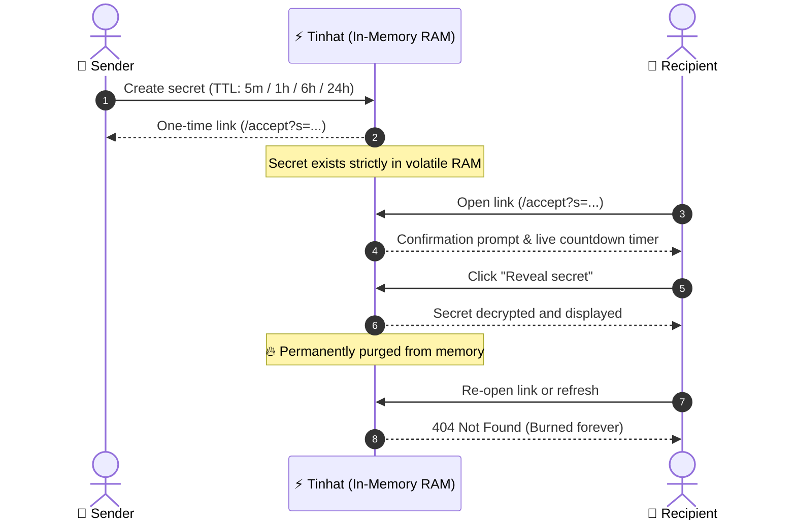

<div align="center">

<br />


# Tinhat
### Share secrets that delete themselves

**A minimalist, zero-trace secret sharing tool.**  
Send passwords, API credentials, and private notes via self-destructing links.  
Permanently destroyed from memory after a single view.

<br />

[-%23f5c842?style=for-the-badge&labelColor=111326)](#-security-model)
[](#-features)
[](#-security-model)
[](LICENSE)

<br />

[Features](#-features) • [Lifetime Options](#-lifetime-options-ttl) • [Lifecycle Flow](#-lifecycle-flow) • [REST API](#-rest-api) • [Security Model](#-security-model)

<br />

</div>

---

## ⚡ Features

* **Instant Access** — Zero signup, zero registration, and zero accounts. Compose and share immediately.
* **Burn on Read** — Secrets are permanently erased from storage the instant they are viewed.
* **Strict Expiration (TTL)** — If unopened, secrets self-destruct automatically once their timer elapses.
* **Ephemeral Storage** — RAM-only by default; optional Redis (e.g. Upstash) with native TTL keeps links alive across restarts and free-tier sleep, storing ciphertext only.
* **Zero-Trace Rate Limiting** — Abuse prevention via ephemeral `HMAC-SHA256` hashes. Raw IP addresses are never logged or stored.
* **No Caching or Indexing** — Strict `no-store` headers and `noindex` directives ensure secrets never linger in caches or search engines.

---

## ⏳ Lifetime Options (TTL)

Choose the exact lifespan for each secret link:

| Lifetime | Seconds | Best Used For |
| :--- | :--- | :--- |
| **5 minutes** | `300` | High-security ephemeral tokens, OTPs, or real-time verification |
| **1 hour** *(Default)* | `3600` | Standard secure transfer via chat, email, or tickets |
| **6 hours** | `21600` | Intra-day sharing across teams and working hours |
| **24 hours** | `86400` | Maximum window for asynchronous recipients in different time zones |

---

## 🔄 Lifecycle Flow



---

## 🔌 REST API

Tinhat provides a clean, minimalistic API for automated pipelines, scripts, and terminal usage:

| Method | Endpoint | Description |
| :--- | :--- | :--- |
| `POST` | `/api/secrets` | Create a new secret (`text` up to 10,000 chars, `lifetime` 300..86400) |
| `GET` | `/api/secrets/{id}` | Inspect secret status and remaining seconds until auto-burn |
| `POST` | `/api/secrets/{id}/accept` | **Burn & Read**: Retrieves the stored payload and immediately purges it (`pop` / atomic `GETDEL`) |
| `GET` | `/api/quota` | Check client rate limit status and remaining daily quota |
| `GET` | `/api/health` | Service healthcheck (storage backend; secret count in memory mode). Never queries Redis, so it is safe as a keep-alive ping |

### Quick cURL Example

```bash
# Create a secret that expires in 1 hour
curl -X POST https://your-tinhat-domain/api/secrets \
  -H "Content-Type: application/json" \
  -d '{"text": "sk-live-super-secret-token", "lifetime": 3600}'
```

> [!NOTE]
> When `REQUIRE_E2EE` is on (the default with `REDIS_URL`), plaintext payloads are rejected with `400`; only browser-encrypted `e2ee:v1:` payloads are accepted.

---

## 🚀 Free Hosting: Render + Upstash

Render's free tier spins the service down after ~15 minutes without traffic, which wipes in-memory secrets. Use Redis so links survive sleep, restarts and redeploys:

1. **Upstash** → create a Redis database in the same region as your Render service and copy its `rediss://default:<password>@<host>.upstash.io:6379` URL. Use a dedicated database (capacity is checked with `DBSIZE`).
2. **Render** → *Environment* → add `REDIS_URL=<that URL>` (plus `TRUST_PROXY=true`, `SITE_URL=https://<app>.onrender.com`).
3. *(Optional)* **Keep-alive** to avoid the ~1 min cold start: on [cron-job.org](https://cron-job.org) ping `https://<app>.onrender.com/health` with schedule `*/10 6-23 * * *` and timezone `Europe/Kyiv` (DST handled automatically). The service then sleeps roughly 00:05–06:00.

Budget: one free service running 24/7 needs ≤ 744 h/month (Render grants 750 h). Each secret costs ~4 Redis commands (`DBSIZE`, `SET … EX`, `GET`, `GETDEL`), far below Upstash's free 500K commands/month.

---

## 🛡️ Security Model

> [!IMPORTANT]
> **Tinhat** is designed around zero persistence and minimal attack surface.

1. **Ephemeral Storage**: In-memory by default (lost on restart). With `REDIS_URL`, secrets are Redis keys whose TTL equals their lifetime, and only client-encrypted `e2ee:v1` payloads are accepted (`REQUIRE_E2EE`); the key stays in the URL `#fragment`, so neither the server nor the Redis provider can read secrets.
2. **True Single-View Guarantee**: Reading a secret executes an immediate eviction (`pop` in memory, atomic `GETDEL` in Redis). Subsequent visits permanently return `404 Not Found`.
3. **Privacy-Preserving Rate Limits**:
   - `5 creations / minute`, `20 creations / day`.
   - Tracked via one-way salted `HMAC-SHA256` tokens with a cryptographic salt rotated on startup.
   - Keys include the hashed client IP (IPv6 grouped by `/64`), an optional anonymous `HttpOnly` cookie, and an optional client-generated device token.
   - Clearing `localStorage` cannot reset the limit; the cookie survives it, and the IP bucket survives cookie clearing.
   - Raw IP addresses and client identifiers are **never saved**.
   - Counters are process-local: a restart (or a second worker/replica) starts with a fresh window. Run a single worker, or move counters to a shared store such as Redis if you need the limit to survive restarts.
4. **Leak Prevention**:
   - Headers: `Cache-Control: no-store, no-cache, must-revalidate`
   - Search Engines: `X-Robots-Tag: noindex, nofollow, noarchive`
   - Navigation: `Referrer-Policy: no-referrer`

---

<div align="center">

Crafted with respect for privacy and digital confidentiality.

**Tinhat — Share secrets that delete themselves.**

</div>
