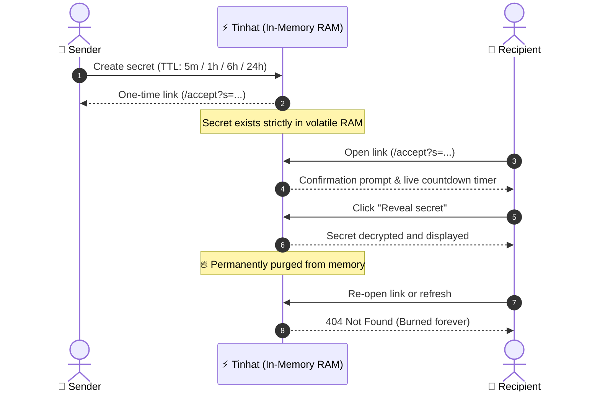

<div align="center">

<br />


# Tinhat
### Share secrets that delete themselves

**A minimalist, zero-trace secret sharing tool.**  
Send passwords, API credentials, and private notes via self-destructing links.  
Permanently destroyed from memory after a single view.

<br />

[](#-security-model)
[](#-features)
[](#-security-model)
[](LICENSE)

<br />

[Features](#-features) • [Lifetime Options](#-lifetime-options-ttl) • [Lifecycle Flow](#-lifecycle-flow) • [REST API](#-rest-api) • [Security Model](#-security-model)

<br />

</div>

---

## ⚡ Features

* **Instant Access** — Zero signup, zero registration, and zero accounts. Compose and share immediately.
* **Burn on Read** — Decrypted secrets are permanently erased from memory the instant they are viewed.
* **Strict Expiration (TTL)** — If unopened, secrets self-destruct automatically once their timer elapses.
* **RAM-Only Architecture** — Nothing touches disk, databases, swap files, or persistent storage.
* **Zero-Trace Rate Limiting** — Abuse prevention via ephemeral `HMAC-SHA256` hashes. Raw IP addresses are never logged or stored.
* **No Caching or Indexing** — Strict `no-store` headers and `noindex` directives ensure secrets never linger in caches or search engines.

---

## ⏳ Lifetime Options (TTL)

Choose the exact lifespan for each secret link:

| Lifetime | Seconds | Best Used For |
| :--- | :--- | :--- |
| **5 minutes** | `300` | High-security ephemeral tokens, OTPs, or real-time verification |
| **1 hour** *(Default)* | `3600` | Standard secure transfer via chat, email, or tickets |
| **6 hours** | `21600` | Intra-day sharing across teams and working hours |
| **24 hours** | `86400` | Maximum window for asynchronous recipients in different time zones |

---

## 🔄 Lifecycle Flow



---

## 🔌 REST API

Tinhat provides a clean, minimalistic API for automated pipelines, scripts, and terminal usage:

| Method | Endpoint | Description |
| :--- | :--- | :--- |
| `POST` | `/api/secrets` | Create a new secret (`text` up to 10,000 chars, `lifetime` 300..86400) |
| `GET` | `/api/secrets/{id}` | Inspect secret status and remaining seconds until auto-burn |
| `POST` | `/api/secrets/{id}/accept` | **Burn & Read**: Retrieves decrypted text and immediately purges from memory |
| `GET` | `/api/quota` | Check client rate limit status and remaining daily quota |
| `GET` | `/api/health` | Service healthcheck and active in-memory secret count |

### Quick cURL Example

```bash
# Create a secret that expires in 1 hour
curl -X POST https://your-tinhat-domain/api/secrets \
  -H "Content-Type: application/json" \
  -d '{"text": "sk-live-super-secret-token", "lifetime": 3600}'
```

---

## 🛡️ Security Model

> [!IMPORTANT]
> **Tinhat** is designed around zero persistence and minimal attack surface.

1. **Volatile RAM Only**: Secrets exist solely as ephemeral in-memory objects. They never touch disks, databases, or swap space.
2. **True Single-View Guarantee**: Reading a secret executes an immediate memory eviction (`pop`). Subsequent visits permanently return `404 Not Found`.
3. **Privacy-Preserving Rate Limits**:
   - `5 creations / minute`, `20 creations / day`.
   - Tracked via one-way salted `HMAC-SHA256` tokens with a cryptographic salt rotated on startup.
   - Raw IP addresses and client identifiers are **never saved**.
4. **Leak Prevention**:
   - Headers: `Cache-Control: no-store, no-cache, must-revalidate`
   - Search Engines: `X-Robots-Tag: noindex, nofollow, noarchive`
   - Navigation: `Referrer-Policy: no-referrer`

---

<div align="center">

Crafted with respect for privacy and digital confidentiality.

**Tinhat — Share secrets that delete themselves.**

</div>
